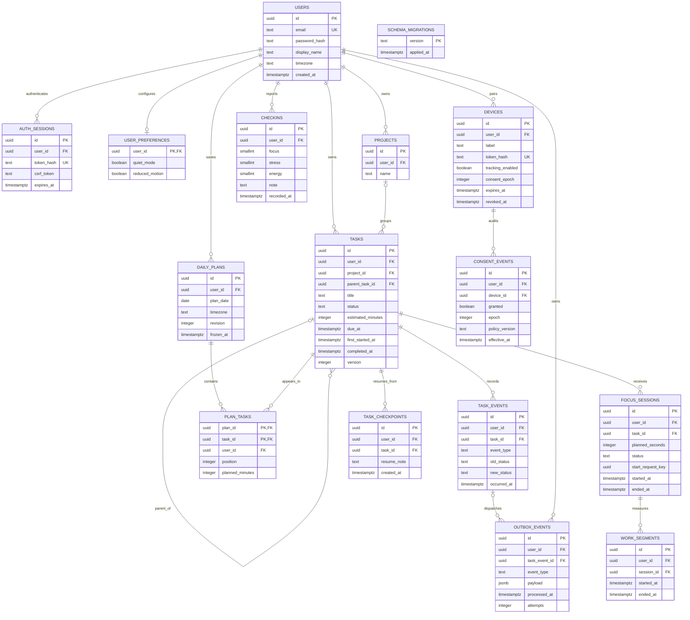

# Database design of the implemented core

The executable definition is `db/001_schema.sql`. It contains 16 tables, including the migration ledger. Earlier 26-table diagrams describe a broader proposal.

## Why two databases?

PostgreSQL owns transactional facts: accounts, task relationships, immutable plan revisions, focus segments, check-ins and consent. For example, a focus start must create both its session and its first segment; a partial write would make time reports unreliable. SQL transactions and constraints make this relationship explicit.

MongoDB owns optional timestamped browser observations. Interval and tab-transition documents have different fields. They are stored with per-event identities, user/time indexes and expiration timestamps. The API validates their allowed shapes before insertion. This demonstrates document storage and event retention alongside relational workflows.

Both systems could be implemented using PostgreSQL alone. MongoDB is a deliberate educational design choice, not a claim that SQL cannot store events. Its cost is a second operational dependency and no built-in foreign key to SQL users or devices. The API must validate those references. Daily reports query both stores; they are not a globally atomic snapshot.

## Relational ER diagram

A crow's-foot line ending in `o{` means zero or more rows. Optional project and parent relationships are shown with `o|`. Every owner column references users; selected ownership edges are shown below to keep the diagram readable. The SQL file includes all foreign keys.



Common creation timestamps are omitted from some diagram boxes for readability; the SQL file is authoritative. `schema_migrations` is an independent technical ledger.

## Integrity and normalization

- Each entity has a primary key. Email and token hashes are unique.
- `plan_tasks` resolves the many-to-many relationship between tasks and plan revisions with primary key `(plan_id, task_id)`.
- `(user_id, id)` unique keys allow composite foreign keys to enforce that a task and its project, parent, session or plan membership belong to one account.
- Check constraints restrict task states, check-in ratings, positive estimates and chronological endpoints.
- Partial unique indexes permit only one unfinished session and one open work segment per user.
- API mutations use a per-user transaction lock to serialize competing workflow changes. Optimistic task versions reject stale edits.
- Frozen plan and membership triggers prevent modifying a committed plan. The API creates a new revision instead.
- Planned estimates are deliberately copied into plan membership. They describe the estimate at planning time, even if the task estimate later changes.
- History, segments and checkpoints are separate rows rather than repeating columns on a task. Ownership columns are intentional redundancy for integrity checks.

A single-level task hierarchy is enforced by the API; SQL prevents direct self-parenting but does not independently enforce the full hierarchy rule. SQL does not install row-level security: API owner filters and composite keys provide application-level isolation. Direct database credentials therefore grant broader access.

## MongoDB collections

`activity_events` stores one observation per document. Common fields: userId, deviceId, eventId, type, at, epoch, digest, expiresAt. Interval documents additionally contain start, end, state, domain and category. Tab-transition documents do not contain page metadata.

- Unique index `(userId, deviceId, eventId)` prevents duplicate storage.
- Index `(userId, at)` supports time-bounded reports.
- TTL index on `expiresAt` expires events 30 days after their event time. TTL removal is asynchronous; report/export queries also filter expired records.
- Uploads accept at most 200 events, with a maximum interval duration of 61 seconds and an upload age of seven days.
- Reusing an event identity with different validated contents is rejected.

`task_event_mirror` is a derived outbox demonstration, not the authoritative task history. Its unique `outboxId` makes retries safe. The worker writes MongoDB before marking SQL delivery complete. A crash between those operations causes a repeat upsert, not another event. Mirror documents expire after 30 days from delivery; authoritative SQL history remains.

There is no distributed transaction. Partial event-batch writes may exist after a failure; clients retry stable event IDs. Consent is checked under the same per-user lock used by revocation. Browser-record deletion commits consent revocation first, then removes events; a deletion failure leaves tracking disabled and can be retried.

## Calculations

For report day D in the account's time zone, compute its local midnight boundaries [d0,d1). Day length can differ from 24 hours during daylight-saving transitions.

For observed intervals Ii=[si,ei), reported duration is:

`T(D) = measure(union(Ii intersect [d0,d1))) / 1000`

Merging overlapping intervals prevents two devices from doubling total active time. Active, idle and per-domain totals are separate unions: overlaps across states or domains mean these component totals need not sum to the overall observed time.

- Hourly values use the same clipping and union calculation within each hour.
- Tab transitions count events with `d0 <= at < d1`. They are not inferred interruptions or attention scores.
- Focus duration merges work segments after day clipping; an open segment ends at the report's current server time. Paused time has no open segment.
- Completed tasks count distinct task IDs with a completion event during the day. Reopening a task does not erase that historical event.
- Original-plan completion uses the first frozen revision and counts members with a completion event after freezing and before the end of that day. A task completed before freezing does not count. An empty denominator returns null.
- Highest stress / lowest focus are extrema among entered check-ins, with the earliest tied entry displayed. They are not claims about unobserved hours.
- Missing observations remain unknown. No percentage coverage is computed because no intended observation schedule exists.

## Example inspection queries

Run SQL with `docker compose exec postgres psql -U steady -d steady`:

```sql
-- Task states per account; suitable for a demonstration database.
SELECT user_id, status, count(*) FROM tasks GROUP BY user_id, status;

-- Recorded work per task, excluding pauses.
SELECT f.task_id,
       sum(extract(epoch FROM (coalesce(w.ended_at, now())-w.started_at))) AS seconds
FROM focus_sessions f JOIN work_segments w ON w.session_id=f.id
GROUP BY f.task_id;

-- Pending cross-database deliveries.
SELECT count(*) FROM outbox_events WHERE processed_at IS NULL;
```

For a real user-facing query, always bind the authenticated user's ID as a parameter. Never interpolate user-provided SQL fragments.
