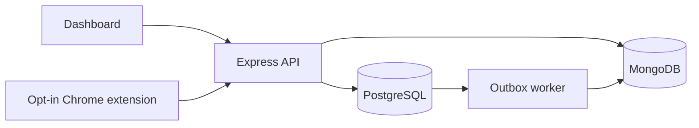

# Explain Steady in simple language

Steady helps a person answer three questions: What should I do next? Where did I stop? What happened during my day?

A user creates a task such as “Finish the DBMS assignment,” splits it into small steps, and saves a daily plan. A focus session records the time they deliberately spend on one task. When interrupted, they pause and leave a resume note such as “Next: add the foreign keys.” On returning, that note helps them restart. Optional check-ins capture their own ratings of focus, stress and energy.

If the user enables the Chrome extension, Steady can also show observed browser time and tab transitions. This context can help someone reflect, but it does not establish whether they were attentive or productive. Reading a single page for a long time may be useful work; many switches may also be useful work.

## Components in everyday language

| Component | What it does | Why it exists |
|---|---|---|
| Dashboard: HTML/CSS/JavaScript | Screens, buttons, forms and charts | The user's workspace |
| Express on Node.js | Receives requests and checks permissions | Prevents the browser from writing arbitrary database records |
| PostgreSQL | Stores users, tasks, plans and focus records | Keeps related facts consistent with keys and transactions |
| MongoDB | Stores browser observation documents and a task-event mirror | Keeps timestamped event records with expiration and duplicate protection |
| Chrome extension, Manifest V3 | Observes permitted browser metadata after consent | Supplies optional activity context |
| Docker Compose | Starts the application and both databases | Makes local demonstration setup repeatable |
| Zod / Luxon / scrypt | Validate input / handle time zones / protect passwords | Reduce invalid data and security mistakes |

Both databases run inside the local Compose network. Only the application's port is published, bound to the computer's loopback address. The browser never receives database credentials. The API combines SQL records and MongoDB observations into a daily report.

## Eight-minute demonstration

1. Create an account. Explain that the account starts with no activity records.
2. Create a project and a task with two subtasks. Open task details to show editing and history.
3. Save the daily plan. Save another revision and explain why the original plan remains unchanged.
4. Start a focus session. Pause, leave a resume note, resume and finish. Explain that the recorded segments omit paused time.
5. Complete a subtask, then the remaining subtask and parent. Show task history.
6. Add two check-ins with different ratings. Show their timestamps and the reported extrema.
7. Pair Chrome, explicitly enable tracking, browse normal pages, then refresh My insights. Explain the distinction between browser activity and self-reported focus.
8. Pause tracking, revoke access or delete browser records. Show that tasks and check-ins remain available.

Use accounts created for demonstration rather than personal browsing history. Integration test records are clearly named “Integration test” and “Integration task.” The UI contains no sample analytics presented as real observations.

## Useful DBMS talking points

- A task's project must belong to the same user: a composite foreign key enforces this.
- A user cannot have two unfinished focus sessions: a partial unique index enforces this.
- Starting focus updates the task, creates history, creates a session and opens a segment in one SQL transaction.
- Frozen plans reject changes through triggers. Replanning creates a new version.
- A retried upload uses the same event identifier, so MongoDB does not count it twice.
- The SQL outbox and an idempotent MongoDB mirror demonstrate eventual consistency without claiming a cross-database transaction.

## Limits to explain honestly

This is a local academic implementation, not a clinically validated intervention. It has no ADHD symptom scoring, personal baseline detector, causal analysis, notification attribution, sleep tracking, mobile-app tracking or automated intervention. Categories are user-selected and are not a productivity score. Browser samples are approximate and can be missing. Focus timers require the user to pause or finish; reaching the planned duration does not end a session automatically.

There is no password recovery, email verification, deployment hardening, account deletion interface or migration tooling for an already divergent schema. Do not expose this demonstration directly to the internet. See verification status for tests still requiring a working runtime.
